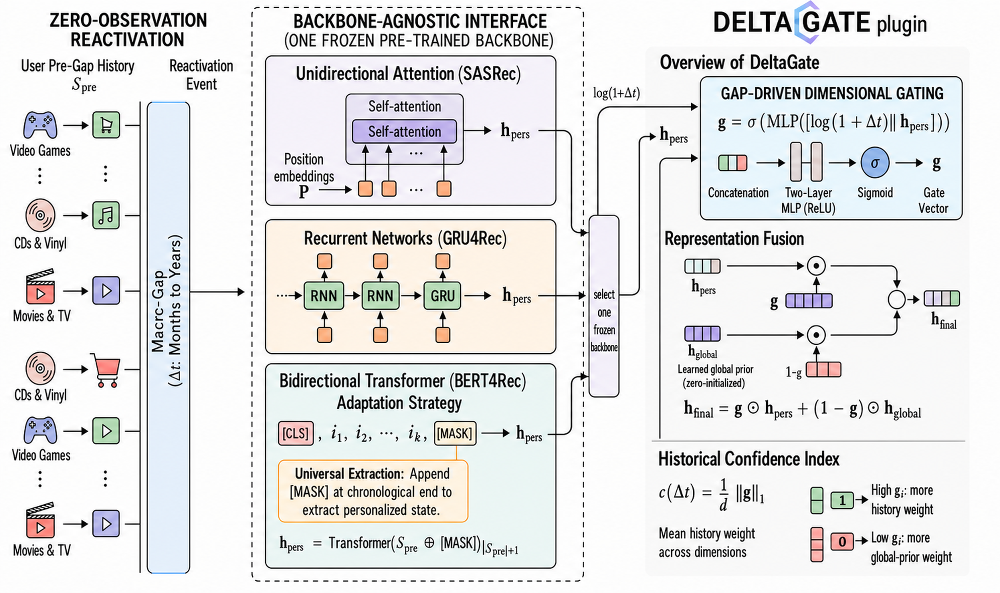

# Zero-Observation User Reactivation with Gap-Driven Dimensional Gating

This repository contains the public code artifact for **DeltaGate**, the method
introduced in the RecSys 2026 main-track paper:

> Zero-Observation User Reactivation with Gap-Driven Dimensional Gating

DeltaGate targets **zero-observation user reactivation**: a user has a useful
pre-gap interaction history, but the platform observes no behavioral signal
during a long inactivity gap. The method keeps a sequential recommendation
backbone frozen and learns a lightweight, gap-conditioned dimensional gate that
routes the final user representation between the historical representation and a
learned global prior.

## Overview

The repository includes standard sequential backbones, DeltaGate plugin
variants, training and full-ranking evaluation entrypoints, lightweight checks,
and aggregated paper-result summaries.



Figure 3 from the paper summarizes the setup: a pre-gap user history is encoded
by one frozen backbone, DeltaGate receives the exposed user representation and
the post-sequence gap, and the final representation is produced by
dimension-wise fusion.

## Repository Layout

| Path | Purpose |
|---|---|
| `src/` | SASRec, GRU4Rec, BERT4Rec, TiSASRec, and DeltaGate model implementations |
| `train.py` | Training entrypoint for backbone and DeltaGate variants |
| `evaluate_offline.py` | Full-ranking offline evaluation entrypoint |
| `data_adapter.py` | Loader for processed monolithic or sharded data |
| `data/README.md` | Expected processed-data schema |
| `results/` | Aggregated paper-result summaries and machine-readable tables |
| `experiments/recsys2026/` | Exact audited runners, code snapshots, configs, and input manifests |
| `tests/` | Smoke and checkpoint-compatibility checks |
| `docs/PROJECT.md` | Additional artifact scope and reproduction notes |

## Environment

Install the Python dependencies with:

```bash
python3 -m pip install -r requirements.txt
```

The code was written for Python 3.9+ and PyTorch 2.x. GPU acceleration is
recommended for full training runs, but the smoke test runs without the Amazon
datasets.

## Quick Smoke Test

Run this command to verify imports and model forward passes:

```bash
python3 tests/smoke_imports.py
```

Expected output:

```text
Smoke test passed.
```

You can also inspect the command-line interfaces without data:

```bash
python3 train.py --help
python3 evaluate_offline.py --help
```

## Data

Raw Amazon review files, processed pickle files, and checkpoints are not
included in this repository. To run training or evaluation, prepare processed
files and place them under `data/`:

```text
data/
|-- amazon_cds_vinyl_processed.pkl
|-- amazon_movies_tv_processed.pkl
`-- amazon_video_games_processed.pkl
```

Each processed dataset should provide:

- `train_samples`: training examples, or sharded training metadata
- `test_samples`: full-ranking test examples
- `item_vocab_size`: item vocabulary size
- `max_len`: maximum sequence length

Each sample should contain:

- `seq_idx`: historical item ids, left-padded by the batching code
- `target_idx`: held-out target item id
- `bucket`: inactivity-gap bucket label, such as `30-90d` or `>365d`
- `gap_days`: inactivity gap in days, required by DeltaGate models
- `intervals`: intra-sequence intervals, required by TiSASRec

See `data/README.md` for the detailed data contract.

## Training

For exact paper-protocol reproduction, start with
`experiments/recsys2026/README.md`. It preserves the eval-mode frozen-backbone
fit, fixed Adam learning rate, gradient clipping, historical checkpoint
selection rule, and fail-closed input hashes used by the claim-bearing runs.
The root entrypoint below is intended for ordinary use on newly prepared data.

Train a backbone first:

```bash
python3 train.py \
    --data data/amazon_movies_tv_processed.pkl \
    --model sasrec \
    --embed-dim 128 \
    --max-len 50 \
    --lr 0.001 \
    --epochs 200 \
    --batch-size 128 \
    --output checkpoints/movies_tv_sasrec_seed42.pt \
    --seed 42 \
    --device auto
```

Then train the corresponding DeltaGate plugin from the pretrained backbone:

```bash
python3 train.py \
    --data data/amazon_movies_tv_processed.pkl \
    --model deltagate-sasrec \
    --backbone checkpoints/movies_tv_sasrec_seed42.pt \
    --embed-dim 128 \
    --max-len 50 \
    --lr 0.001 \
    --epochs 200 \
    --batch-size 128 \
    --output checkpoints/movies_tv_deltagate_sasrec_seed42.pt \
    --seed 42 \
    --device auto
```

Supported models:

- `sasrec`
- `gru4rec`
- `bert4rec`
- `tisasrec`
- `deltagate-sasrec`
- `deltagate-gru4rec`
- `deltagate-bert4rec`

DeltaGate plugin training requires a compatible pretrained backbone checkpoint.
The loader freezes the backbone and item embeddings, then optimizes only
`gate_mlp` and `global_prior`. DeltaGate models also support
`--ablation_mode fixed_gate` and `--ablation_mode prior_only`.

## Evaluation

Evaluate a trained checkpoint with full-ranking evaluation:

```bash
python3 evaluate_offline.py \
    --data data/amazon_movies_tv_processed.pkl \
    --model_path checkpoints/movies_tv_deltagate_sasrec_seed42.pt \
    --model deltagate-sasrec \
    --embed-dim 128 \
    --max-len 50
```

## BERT4Rec and DG-BERT4Rec Note

For the bidirectional backbone, the public implementation appends `[MASK]` at
the chronological end of the pre-gap sequence and uses the final mask hidden
state as the personalized representation. DG-BERT4Rec then applies the same
output-layer DeltaGate fusion used by the other backbone variants.

## Results

The `results/` directory contains aggregated Hit@10 and NDCG@10 summaries for:

- Amazon Video Games
- Amazon CDs & Vinyl
- Amazon Movies & TV

Start with `results/PAPER_RESULTS.md`. The canonical audited claim surface is
`results/formal_claims.json`; convenience summaries are also provided in
`results/results.json`, `results/results_all.json`, and
`results/results_e2e.json`.

## Scope Boundaries

- Raw Amazon review data is not included.
- Processed dataset pickle files are not included.
- Checkpoints are not included.
- Full reproduction requires preparing the processed data files described in
  `data/README.md`.
- This repository is a paper-facing code artifact, not a packaged Python
  library.

## Citation

```bibtex
@inproceedings{ding2026deltagate,
  title = {Zero-Observation User Reactivation with Gap-Driven Dimensional Gating},
  author = {Ding, Jiandong and Liu, Tianying and Liu, Fuyuan and Qin, Huijie and Wu, Tiandeng},
  booktitle = {Proceedings of the 20th ACM Conference on Recommender Systems},
  year = {2026},
  doi = {10.1145/3773078.3831771}
}
```

## License

This repository is released under the license in `LICENSE`.
